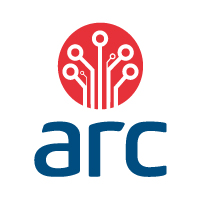
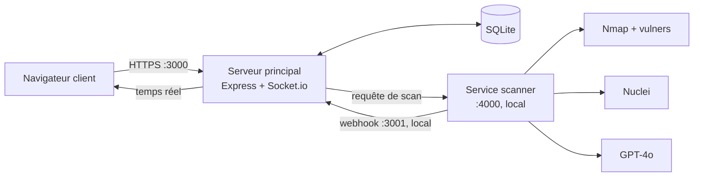

<p align="center">
  
</p>

<h1 align="center">ARC Scanner</h1>

<p align="center">
  <b>Plateforme web de scan de vulnérabilités réseau avec analyse IA et suivi par tickets</b><br>
  Projet réalisé en stage chez <b>ARC Informatique</b> (Dakar, Sénégal)
</p>

<p align="center">
  
  
  
  
  
  
  
</p>

---

## Présentation

ARC Scanner permet à un client de lancer un audit de sécurité sur sa machine en un clic. La plateforme enchaîne un scan **Nmap** (services, versions, CVE connues via `vulners`) et un scan **Nuclei** (templates de vulnérabilités actives), puis demande à **GPT-4o** de rédiger une analyse claire : sévérité globale, explication de chaque faille et recommandations.

Chaque scan ouvre un **ticket**. Le client et l'équipe IT y échangent en temps réel, suivent l'avancement du scan et téléchargent le rapport.

## Fonctionnalités

- 🔍 **Scan automatisé** : Nmap `-sV --script vulners` + Nuclei (critical / high / medium). Voir la [couverture CVE](CVE_COVERAGE.md)
- 🤖 **Analyse IA** : synthèse des résultats bruts par GPT-4o (vulnérabilités, sévérité, remédiations)
- 🎫 **Tickets temps réel** : statut du scan et messagerie client ↔ IT via Socket.io, pièces jointes, rapports téléchargeables
- 👥 **3 rôles** : `admin`, `it`, `client`, chacun avec ses droits d'accès
- 📜 **Journalisation** : logs de connexion et d'actions, consultables et exportables par l'admin et l'équipe IT

## Architecture



Le service de scan et le webhook n'écoutent qu'en local (`127.0.0.1`). Ils s'authentifient avec une clé partagée (`SCANNER_API_KEY`).

## Sécurité

| Mesure | Détail |
|--------|--------|
| HTTPS | Certificat TLS chargé depuis des fichiers, clé privée exclue du dépôt |
| Mots de passe | Hachage **bcrypt** |
| Anti-bruteforce | Rate limiting sur la connexion et **verrouillage progressif** : 2 min, puis 1 h, puis blocage jusqu'à déblocage par un admin |
| En-têtes HTTP | **Helmet** avec Content Security Policy |
| Validation des entrées | Contrôle strict de l'IP cible avant toute commande système |
| Concurrence | Un seul scan simultané par compte |
| Secrets | Clés API et secrets de session dans `.env`, jamais commités |

---

## Prérequis

- [Node.js](https://nodejs.org/) v18 ou supérieur
- [Nmap](https://nmap.org/download.html) — doit être accessible via la commande `nmap` dans le terminal
- [Nuclei](https://github.com/projectdiscovery/nuclei/releases) — doit être installé dans `C:\Program Files\nuclei_3.8.0_windows_amd64\`
- Une clé API [OpenAI](https://platform.openai.com/api-keys)

---

## Installation

### 1. Cloner le repo

```bash
git clone https://github.com/Tontongroudy/ARC-scanner.git
cd ARC-scanner
```

### 2. Installer les dépendances du serveur principal

```bash
npm install
```

### 3. Installer les dépendances du service scanner

```bash
cd scanner
npm install
cd ..
```

### 4. Configurer les variables d'environnement

Crée un fichier `.env` à la racine du projet :

```env
OPENAI_API_KEY=sk-...       # Ta clé API OpenAI
SESSION_SECRET=une_chaine_longue_aleatoire_et_unique
SCANNER_API_KEY=une_autre_chaine_secrete_pour_le_scanner
```

### 5. Générer un certificat SSL

Le projet requiert un certificat SSL pour tourner en HTTPS. Génère un certificat auto-signé avec OpenSSL :

```bash
# Créer le dossier ssl s'il n'existe pas
mkdir ssl

# Générer la clé privée et le certificat (valable 1 an)
openssl req -x509 -newkey rsa:2048 -keyout ssl/key.pem -out ssl/cert.pem -days 365 -nodes -subj "/CN=localhost/O=ARC" -addext "subjectAltName=IP:127.0.0.1"
```

> **Note :** En production, remplace le certificat auto-signé par un vrai certificat (Let's Encrypt via Certbot).

---

## Lancement

Le projet se compose de **deux services** à lancer séparément dans deux terminaux.

### Terminal 1 — Serveur principal (HTTPS :3000 + Webhook HTTP :3001)

```bash
cd ARC-scanner
node server.js
```

### Terminal 2 — Service scanner (HTTP :4000)

```bash
cd ARC-scanner/scanner
node scanner_service.js
```

> Le service scanner doit être lancé depuis le dossier `scanner/`, pas depuis la racine.

L'application est accessible sur : `https://localhost:3000`

> Le navigateur affichera un avertissement SSL (certificat auto-signé). Clique sur "Avancer quand même".

### Ports utilisés

| Port | Service | Protocole |
|------|---------|-----------|
| 3000 | Serveur principal (interface web + API) | HTTPS |
| 3001 | Webhook interne (retour des résultats du scanner) | HTTP local uniquement |
| 4000 | Service scanner (Nmap + Nuclei + IA) | HTTP local uniquement |

---

## Première connexion

Un compte administrateur est créé automatiquement au premier démarrage :

| Champ | Valeur |
|-------|--------|
| Email | `admin@arc.sn` |
| Mot de passe | `admin123` |

> ℹ️ Ces identifiants sont donnés **à titre d'exemple**, pour tester le projet en local. Ils ne correspondent à aucun compte réel et ne sont utilisés sur aucune instance déployée. De même, la valeur de secours de `SESSION_SECRET` dans `server.js` ne sert qu'en développement : il faut toujours définir ce secret dans le `.env`.

**Change ce mot de passe immédiatement** après la première connexion via Paramètres.

---

## Structure du projet

```
ARC-scanner/
├── server.js               # Serveur principal Express (HTTPS :3000 + Webhook HTTP :3001)
├── scanner/
│   ├── scanner_service.js  # Service de scan Nmap + Nuclei + IA (HTTP :4000)
│   ├── package.json
│   └── node_modules/
├── ssl/                    # Certificats SSL (cert.pem commité, key.pem non commité)
├── reports/                # Rapports de scan générés (non commités)
├── uploads/                # Fichiers joints aux messages (non commités)
├── *.html                  # Pages de l'interface web
├── .env                    # Variables d'environnement (non commité)
├── .gitignore
└── package.json
```

---

## Rôles utilisateurs

| Rôle | Accès |
|------|-------|
| `admin` | Gestion des utilisateurs, tous les tickets, logs |
| `it` | Tous les tickets, logs |
| `client` | Ses propres tickets uniquement |

> Les nouveaux comptes créés via l'inscription ont toujours le rôle `client`.

---

## Variables d'environnement

| Variable | Description |
|----------|-------------|
| `OPENAI_API_KEY` | Clé API OpenAI pour l'analyse IA des rapports |
| `SESSION_SECRET` | Clé secrète pour les sessions Express (chaîne aléatoire longue) |
| `SCANNER_API_KEY` | Clé partagée entre le serveur principal et le service scanner |
